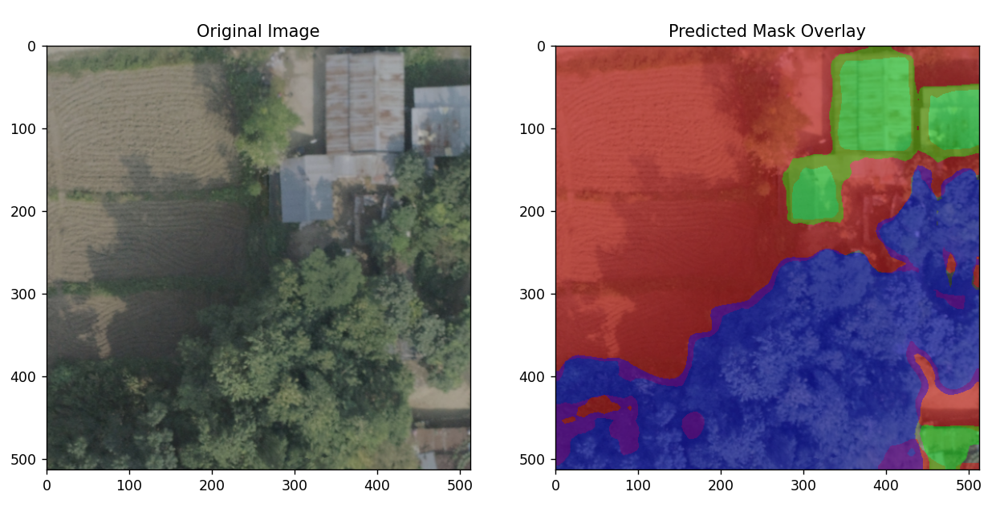
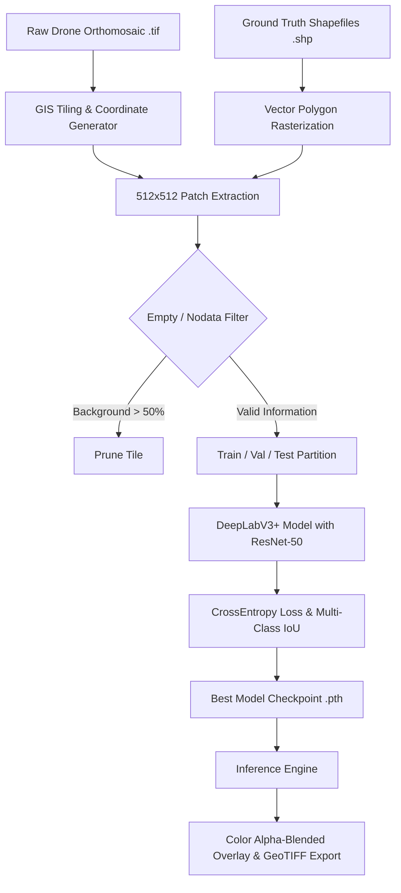

# Drone Image-Based Landcover Segmentation

<div align="center">

[](https://www.python.org/)
[](https://pytorch.org/)
[](https://pytorch.org/vision/stable/index.html)
[]()
[](https://opensource.org/licenses/MIT)
[](https://github.com/Aadarshttech/Drone-Image-Based-Landcover-Segmentation/pulls)

**Automated high-resolution landcover classification and semantic segmentation pipeline for UAV aerial drone orthomosaics.**

*Case Study Area: Butwal Ward No. 6, Rupandehi District, Lumbini Province, Nepal*

[Overview](#-overview) • [Visual Showcase](#-visual-showcase) • [Architecture](#-pipeline-architecture) • [Class Taxonomy](#-landcover-classes) • [Quickstart](#-quickstart-in-60-seconds) • [Pipeline Guide](#-end-to-end-pipeline-guide) • [Dataset](#-dataset-guide) • [CLI Reference](#-command-line-interface) • [License](#-license)

</div>

---

## 📌 Overview

Rapid urbanization and climate vulnerabilities demand frequent, cost-effective, and fine-grained spatial mapping. Traditional satellite imagery often lacks the ground-sampling distance (GSD) required to differentiate dense informal settlements, narrow alleyways, and individual tree canopies. 

This repository provides an **end-to-end deep learning framework** tailored for **high-resolution drone imagery**:
- **Geospatial Preprocessing:** Rasterizes GIS vector shapefiles (`.shp`), aligns coordinate systems (UTM Zone 44N), and slices gigapixel orthomosaics into training patches with sliding-window stride.
- **Data Quality Assurance:** Automatically filters nodata borders and background-dominated tiles to mitigate extreme class imbalance.
- **DeepLabV3+ with Atrous Spatial Pyramid Pooling (ASPP):** Captures multi-scale contextual information with a pre-trained ResNet-50 backbone.
- **Color Overlay Inference:** Generates alpha-blended segmentation maps and per-class diagnostic metrics (mIoU, Pixel Accuracy).
- **Out-of-the-Box Reproducibility:** Includes synthetic demo data and dataset verification tools for instant validation.

---

## 🖼️ Visual Showcase

<div align="center">

### Model Segmentation Overlay
*DeepLabV3 prediction overlay: Building footprints highlighted in **Red**, Woodland/Tree canopy in **Green**.*



</div>

<br>

| GIS Shapefile Annotation | Ground Truth Polygon Tracing | Extracted Patch & Mask Pair |
|:---:|:---:|:---:|
|  |  |  |
| *ArcGIS Pro vector digitizing over drone orthomosaic* | *High-density building and canopy boundary polygons* | *512×512 aerial patch and aligned segmentation mask* |

---

## 🏗️ Pipeline Architecture



---

## 🏷️ Landcover Classes

The model classifies every pixel into three distinct landcover categories:

| Class ID | Class Name | Hex Code | RGB Value | Description |
|:---:|:---|:---:|:---:|:---|
| **0** | **Background / Non-target** | `#000000` | `(0, 0, 0)` | Roads, pedestrian pathways, open soil, parking lots, unclassified space |
| **1** | **Buildings / Built-Up** | `#FF0000` | `(255, 0, 0)` | Residential houses, commercial establishments, tin & concrete roofs |
| **2** | **Woodland / Vegetation** | `#00FF00` | `(0, 255, 0)` | Trees, forest patches, dense shrubbery, agricultural greenery |

---

## 📁 Repository Structure

```text
Drone-Image-Based-Landcover-Segmentation/
├── README.md                      # Comprehensive project documentation
├── requirements.txt               # Pinned package dependencies
├── setup.py                       # Package installation config
├── LICENSE                        # MIT License
├── inference.png                  # Sample model inference visualization
│
├── src/                           # Core modular source code
│   ├── __init__.py                # Package exports
│   ├── model.py                   # DeepLabV3+ architecture with custom heads
│   ├── dataset.py                 # PyTorch LandcoverDataset & DataLoader factory
│   ├── metrics.py                 # Multi-class IoU, mIoU, and Pixel Accuracy
│   ├── preprocess.py              # Sliding-window patch extraction & data cleaning
│   └── utils.py                   # Alpha overlays, colormaps, and plotting tools
│
├── data/                          # Dataset guides, verifiers, and samples
│   ├── README.md                  # Comprehensive dataset guide & specs
│   ├── verify_dataset.py          # Dataset validator and class statistics reporter
│   ├── generate_sample_data.py    # Synthetic demonstration data generator
│   ├── annotation image example.png
│   ├── correspondig image and mask.png
│   ├── gis data screenshot example.png
│   └── sample/                    # Included mini-dataset for instant testing
│       ├── images/ (train, val, test)
│       └── masks/  (train, val, test)
│
├── train.py                       # Modern training CLI with early stopping
├── inference.py                   # Single image / batch inference CLI
├── preprocess.py                  # Patch extraction and cleaning CLI
├── project.ipynb                  # Interactive Jupyter Notebook pipeline
│
└── (Legacy Backwards-Compatible Wrappers)
    ├── deemodel.py                # Imports and delegates to src.model
    ├── generator2.py              # Imports and delegates to src.dataset
    ├── trygen.py                  # Imports and delegates to src.dataset
    ├── train4.py                  # Legacy entrypoint calling train.py
    ├── newtest4.py                # Legacy entrypoint calling inference.py
    ├── check2.py                  # Legacy cleaner calling src.preprocess
    └── utils.py                   # Legacy wrapper for GIS & plotting utilities
```

---

## ⚡ Quickstart in 60 Seconds

### 1. Clone & Set Up Environment

```bash
git clone https://github.com/Aadarshttech/Drone-Image-Based-Landcover-Segmentation.git
cd Drone-Image-Based-Landcover-Segmentation

# Create and activate virtual environment (optional but recommended)
python -m venv venv
# Linux / macOS:
source venv/bin/activate
# Windows:
venv\Scripts\activate

# Install dependencies
pip install -r requirements.txt
```

### 2. Verify Sample Dataset

The repository comes with a verified sample dataset in `data/sample/`:

```bash
python data/verify_dataset.py --data-dir data/sample
```

### 3. Run Training (Demo)

Train DeepLabV3 on the demonstration dataset:

```bash
python train.py --data-dir data/sample --epochs 5 --batch-size 2
```

### 4. Run Inference

Generate segmentation overlays on test imagery:

```bash
python inference.py --image data/sample/images/test/sample_drone_test_01.png --output-dir inference_results
```

---

## 🛠️ End-to-End Pipeline Guide

### Phase 1: Data Preparation & Preprocessing

When working with your own raw drone orthomosaics (`.tif`) and shapefiles (`.shp`):

1. **Rasterize Vector Masks**: Convert vector polygons into raster masks aligned with the orthomosaic's projection and pixel grid using `utils.rasterize_masks`.
2. **Extract Patches**: Slices large orthomosaics into 512×512 tiles with a 256-pixel stride (50% overlap):
   ```bash
   python preprocess.py --mode extract --images-dir data/raw/orthomosaics --masks-dir data/raw/masks
   ```
3. **Clean Low-Information Tiles**: Remove tiles dominated by empty background (>50% class 0):
   ```bash
   python preprocess.py --mode clean --images-dir data/patches/images --masks-dir data/patches/masks --empty-threshold 0.50
   ```
4. **Split Dataset**: Partition into 70% Train, 15% Validation, and 15% Test:
   ```bash
   python preprocess.py --mode split --dataset-dir data/patches --output-dir data/splits
   ```

---

### Phase 2: Model Training

Train the segmentation model with customizable parameters:

```bash
python train.py \
    --data-dir data/splits \
    --epochs 100 \
    --batch-size 8 \
    --lr 0.0001 \
    --patience 20 \
    --num-classes 3 \
    --output-dir checkpoints \
    --save-name best_model.pth
```

Key features of the training pipeline:
- **Automatic Device Detection**: Utilizes CUDA GPU acceleration when available, falls back gracefully to CPU.
- **Dynamic Checkpointing**: Saves model weights whenever validation loss reaches a new minimum.
- **Early Stopping**: Prevents overfitting when validation loss fails to improve for `--patience` epochs.
- **Metric History**: Dumps epoch-by-epoch loss and mIoU to `checkpoints/training_history.json`.

---

### Phase 3: Evaluation & Inference

Run inference on a single image or an entire batch of drone images:

```bash
# Single image inference
python inference.py \
    --image path/to/drone_image.jpg \
    --checkpoint checkpoints/best_model.pth \
    --output-dir inference_results \
    --alpha 0.45

# Batch inference on a directory
python inference.py \
    --image-dir data/sample/images/test \
    --checkpoint checkpoints/best_model.pth \
    --output-dir inference_results
```

Generated outputs for each processed image:
1. `*_pred_mask.png`: 8-bit single-channel raw class label map `[0, 1, 2]`.
2. `*_color_mask.png`: RGB colored classification mask based on taxonomy.
3. `*_overlay.png`: Alpha-blended visualization over the original drone photo.
4. `*_comparison.png`: Side-by-side diagnostic figure (Input Image vs. Prediction Overlay).

---

## 📊 Command Line Interface

### `train.py` Options

| Flag | Type | Default | Description |
|---|:---:|:---:|---|
| `--data-dir` | `str` | `./data/sample` | Root path to dataset containing `images/` and `masks/` |
| `--num-classes` | `int` | `3` | Number of output segmentation classes |
| `--epochs` | `int` | `50` | Maximum number of training epochs |
| `--batch-size` | `int` | `4` | Mini-batch size for DataLoader |
| `--lr` | `float` | `0.0001` | Initial learning rate for Adam optimizer |
| `--patience` | `int` | `15` | Early stopping patience (epochs without improvement) |
| `--output-dir` | `str` | `./checkpoints` | Output directory to store `.pth` weights |
| `--save-name` | `str` | `best_model.pth` | Checkpoint filename |
| `--freeze-backbone` | `flag` | `False` | Freeze ResNet-50 feature extractor during training |
| `--device` | `str` | `auto` | Execution device (`cuda`, `cpu`, or `auto`) |

### `inference.py` Options

| Flag | Type | Default | Description |
|---|:---:|:---:|---|
| `--image` | `str` | `None` | Path to single input image file |
| `--image-dir` | `str` | `None` | Path to directory of images to process in batch |
| `--checkpoint` | `str` | `checkpoints/best_model.pth` | Path to trained model weights |
| `--output-dir` | `str` | `inference_results` | Directory where outputs are saved |
| `--alpha` | `float` | `0.45` | Mask overlay transparency (0.0 = image only, 1.0 = mask only) |
| `--device` | `str` | `auto` | Execution device (`cuda`, `cpu`, or `auto`) |

---

## 📈 Evaluation Metrics

The pipeline evaluates performance using standard remote sensing segmentation metrics:

$$\text{IoU}_c = \frac{\text{TP}_c}{\text{TP}_c + \text{FP}_c + \text{FN}_c}$$

$$\text{mIoU} = \frac{1}{N} \sum_{c=1}^{N} \text{IoU}_c$$

$$\text{Overall Pixel Accuracy} = \frac{\sum_{c} \text{TP}_c}{\text{Total Pixels}}$$

---

## 🗺️ Roadmap & Future Enhancements

- [x] Refactor into modular architecture (`src/model.py`, `src/dataset.py`, `src/metrics.py`)
- [x] Standalone dataset integrity checker and synthetic sample data generator
- [x] Backward-compatible wrappers for legacy scripts (`train4.py`, `newtest4.py`, `check2.py`)
- [ ] Add YOLOv8-seg benchmark scripts and comparative analysis
- [ ] Implement Test-Time Augmentation (TTA) for seamless stitching of overlapping tiles
- [ ] Direct GeoTIFF georeferenced shapefile export of predicted building footprints
- [ ] Interactive Streamlit / Gradio web demo for drag-and-drop drone image segmentation

---

## 👥 Authors & Acknowledgments

- **Aadarsh Pandita** ([@Aadarshttech](https://github.com/Aadarshttech))
- **Aayush Gautam** ([@Mastermind305](https://github.com/Mastermind305))

Special thanks to the Butwal local municipality survey datasets and the open-source PyTorch & GeoPandas communities.

---

## 📄 License

This project is licensed under the MIT License — see the [LICENSE](LICENSE) file for details.
